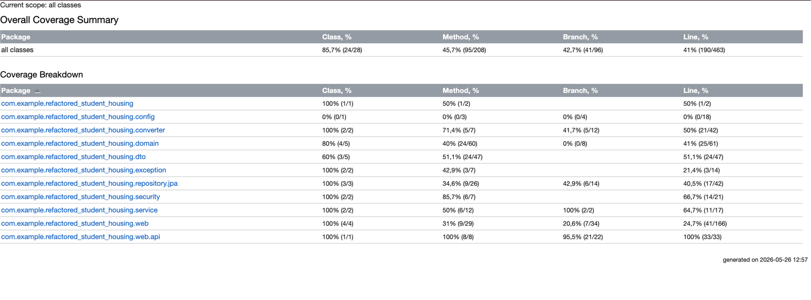

# Programming 5 - Student Housing

## Domain Entities
* **Student**: Users looking for accommodation. Owned by the `AppUser` (advisor) who created it.
* **HousingUnit**: Base class for accommodations (Apartment, Studio).
* **Dorm**: Specific type of unit managed by a dorm manager (single-table inheritance).
* **Lease**: The refactored many-to-many between Student and HousingUnit, modelled as its own
  entity with extra attributes (dates, deposit, active).
* **AppUser**: The persisted user, with a role and an association to the students they advise.

## Architecture

Strict 3-layer architecture, with the boundaries actually enforced:

| Layer | Package | Rules |
| :--- | :--- | :--- |
| Presentation | `web`, `web.api` | Only injects **services**. Binds requests, picks a view or a status code. Contains no domain rules, creates no entities, takes no authorization decisions, filters no collections. |
| Business | `service` | Owns the transaction (`@Transactional`), all domain rules, and the record-level authorization (`@PreAuthorize`). Returns **DTOs**, never entities. |
| Data | `repository` | Plain Spring Data `JpaRepository` interfaces. All filtering is expressed as `WHERE` clauses; associations are loaded with `JOIN FETCH`. |

Consequences worth knowing for the exam interview:

* **Open session in view is disabled** (`spring.jpa.open-in-view=false`). Because the templates
  receive DTOs that were fully assembled *inside* the service transaction, no view can trigger a
  lazy load, and no `LazyInitializationException` is possible.
* **Every page render costs a single query.** `GET /students`, `/students/{id}`, `/units` and
  `/units/{id}` each execute exactly one SQL statement (verified with `spring.jpa.show-sql`).
* **All eager loading is disabled**; `@ManyToOne`/`@OneToMany` are explicitly `LAZY` and the data a
  page needs is pulled in with `JOIN FETCH`.
* **Cascading is off except where it is motivated**: `Student → Lease` cascades with
  `orphanRemoval`, because a lease cannot exist without its student. `HousingUnit → Lease` does
  **not** cascade, so deleting a unit never silently destroys lease history.
* **Database filtering only.** Searching, "international only", "top GPA", the per-advisor
  restriction and the unit occupancy check are all SQL (`WHERE` / `COUNT`), never Java stream
  filtering over a full table load.

## Resit preparation

After the first exam I received feedback on open session in view, REST principles, code quality,
controllers building DTOs and entities, database filtering, and business logic sitting in
controllers. This section lists what changed in response, and where to look for each item.

### 1. Open session in view & JPA best practices

`spring.jpa.open-in-view=false` was already set, but the code only survived it by accident:
controllers hand-loaded lazy associations in loops and the templates walked
`student.leases`, `lease.housingUnit` and `lease.student.advisor.username`.

* Every association is now explicitly `LAZY` — including `Student.advisor`, which was implicitly
  **EAGER** and was the only reason the old templates rendered at all.
* The presentation layer receives DTOs that the service assembles **inside** the transaction, so a
  template cannot trigger a lazy load and `LazyInitializationException` is structurally impossible.
* The data each page needs is pulled in with `JOIN FETCH`
  (`StudentRepository#findDetailById`, `HousingUnitRepository#findDetailById`).
* Cascading is off except where it is motivated: `Student → Lease` cascades with `orphanRemoval`
  (a lease cannot exist without its student), `HousingUnit → Lease` does not.
* **Result:** `/students`, `/students/{id}`, `/units` and `/units/{id}` each execute exactly
  **one** SQL statement. Verifiable in the console, since `spring.jpa.show-sql` is on.

### 2. Database filtering

Three separate places loaded the whole table and filtered in Java. All of them are now SQL.

| Before | After |
| :--- | :--- |
| `search(...)` = `findAll()` + Java stream filter | one JPQL query with a `WHERE` clause per criterion |
| `findHighPerformingStudents(gpa)` = `findAll()` + `.filter(s -> s.getGpa() >= gpa)` | the same query, with `minGpa` bound |
| `filterStudentsByRole(...)` in the controller — loaded every student, then dropped rows | `advisorUsername` is a parameter of the query |
| unit occupancy = load all leases of a unit, count in Java | `countByHousingUnitIdAndActiveTrue` |

All student listings (free search, "international only", "top GPA", per-advisor restriction) go
through **one** parameterised query in `StudentRepository#search`; a null parameter disables that
filter. `StudentServiceImplTest` asserts with `verify(...)` that the advisor restriction is passed
*into* the query rather than applied afterwards.

### 3. Controllers reworked

Controllers now inject **only services**, and contain no domain rules. `StudentController` went
from 7 dependencies (4 of them repositories) to 3.

| Was in a controller | Moved to |
| :--- | :--- |
| `StudentApiController` built the `Student` entity and set the gpa / international / birthDate defaults | `StudentService#createFromApi` |
| `StudentController` built a `Lease` with hard-coded deposit and duration | `LeaseService#createStandardLease` |
| `HousingUnitController` copied six properties DTO→entity by hand, twice | `HousingUnitMapper` (MapStruct) |
| `HousingUnitApiController` had a private `toResponse(...)` mapper | `HousingUnitMapper` |
| `rentSubmit` held the whole leasing ruleset (capacity, existing active lease) | `LeaseService#rentUnit` |
| `RegistrationController` did the uniqueness check, password hashing and role assignment | `UserService#register` |
| `filterStudentsByRole` read the `SecurityContextHolder` directly | `StudentService`, via `@AuthenticationPrincipal` |

The DTOs were split by role instead of being reused everywhere: `StudentFormDto` backs the MVC
form, `StudentDto` is the API read model, `StudentListItemDto` / `StudentDetailDto` feed the views,
`LeaseFormDto` replaces binding the `Lease` **entity** straight to a request.

### 4. REST principles

See [REST principles applied](#rest-principles-applied) for the full table. The concrete changes:

* `201 Created` responses now carry a **`Location`** header.
* `GET /units/delete/{id}` was a state change behind a `GET` link (and therefore outside CSRF
  protection). It is now `POST /units/{id}/delete` with a CSRF token. Same for edit:
  `/units/{id}/edit`.
* The exception handling was split in two: `ApiExceptionHandler` answers `/api/**` with
  `application/problem+json`, `GlobalExceptionHandler` renders HTML for the MVC pages. Previously a
  single `@ExceptionHandler(Exception.class)` returned an **HTML page with status 200** for every
  failure — including to JSON clients.
* Validation failures now name the offending fields in the response body instead of returning an
  empty 400.

### 5. Code quality

* Removed the `Repository` + `RepositoryJpa` + `DataJpaRepository` triple layer (a leftover of the
  Programming 3 multi-implementation setup) in favour of plain Spring Data `JpaRepository`
  interfaces — six classes deleted, no behaviour lost.
* Removed the Java `DataSeeder`; users are seeded from `data.sql` with BCrypt hashes, as week 1
  requires. `SeedDataTest` verifies the seeded hashes really match the documented passwords.
* Removed dead code: `addUnitToStudent()` was an empty method that `StudentService#linkUnit()`
  called, so the feature silently did nothing.
* Removed the duplicated `studentId` / `unitId` scalar columns on `Lease` (mapped
  `insertable=false, updatable=false` next to the real associations — a plain-JDBC leftover).
* Moved `application-test.properties` to `src/test/resources`, so test database credentials are no
  longer packaged into the production jar.

### 6. Bugs found and fixed along the way

* **GPA leak on the students list** — two blocks used the *same* `th:unless` condition, so a
  non-owner saw "GPA: Hidden" *and* the real GPA, while the owner saw neither. The service now
  decides visibility and does not send a GPA the viewer may not see.
* **`#authentication.name == 'admin'`** was hard-coded in five templates instead of
  `hasRole('ADMIN')` — a second administrator account would get no admin UI at all.
* **Students created through the API had no advisor**, so nobody except an administrator could ever
  edit or delete them. That breaks the week 5 rule that the creator becomes connected to the record.
* **The cache stored managed entities**, handing detached objects to later transactions. It now
  caches immutable DTOs.
* **Nothing called the `PATCH` endpoint** — `updateGpaAJAX` looked for a `gpa-input-*` element that
  no template rendered. The students list now has an inline GPA editor that calls it (week 3 asks
  for the endpoint to be used from JavaScript).
* A `null` GPA made `${s.gpa >= 3.5}` throw on the list page; the DTO exposes a null-safe
  `highGpa` flag.

### 7. Authorization written once

The rule *"only the owning advisor or an administrator may update/delete"* used to be duplicated as
private helpers in `StudentApiController` and as a filter in `StudentController`. It is now a single
`@PreAuthorize` expression on `StudentService#updateGpa` and `#deleteById`, backed by
`StudentSecurity`. Both the MVC pages and the Web API call that service, so neither can drift from
the other or bypass the check.

## CLI Build & Run Instructions
1.  **Start Database:**
    ```bash
    docker-compose up -d
    ```
2.  **Build Project:**
    ```bash
    ./gradlew build
    ```
3.  **Run Application:**
    ```bash
    ./gradlew bootRun
    ```
    > **Week 11:** the embedded frontend at `src/main/frontend/` is built automatically by Gradle
    > (via the `com.github.node-gradle.node` plugin). On the first run, Gradle downloads Node and
    > installs the npm dependencies; webpack then bundles into
    > `src/main/resources/static/built/bundle.{js,css}`, which Thymeleaf loads from the page `<head>`.
    > No separate npm command is needed — `./gradlew bootRun` (or `bootJar` or `test`) is enough.
4.  **Run All Tests** (against the isolated test database):
    The test database container (`postgres-test`, port `5433`) is started by
    `docker-compose up -d`. All tests run with the `test` Spring profile, which is
    activated automatically via `@ActiveProfiles("test")` on every test class — so a
    single command runs the whole suite:
    ```bash
    ./gradlew test
    ```
    The `test` profile points Spring at `localhost:5433/student_housing_test` and sets
    `spring.sql.init.mode=never`, so `data.sql` is **not** executed and the development
    seed data never reaches the test database. Seeding happens exclusively through
    `data.sql` (there is no Java seeding routine), so disabling it is enough to keep
    the test database clean. Tests arrange their own data.


## REST principles applied

| Principle | How it is applied |
| :--- | :--- |
| **URL patterns** | Nouns, not verbs: the collection is `/api/students`, a single record is `/api/students/{id}`. Filtering uses a query parameter (`/api/students?name=ali`), identity uses a path variable. |
| **HTTP verbs** | `GET` reads, `POST` creates, `PATCH` partially updates, `DELETE` removes. Nothing that changes state is reachable over `GET` — the MVC delete is a `POST` form too, not a link. |
| **Status codes** | `200` read/update, `201` create (with a `Location` header), `204` delete, `400` validation, `403` not your record, `404` unknown record, `409` business-rule conflict. |
| **Content negotiation** | Every endpoint declares `consumes`/`produces` `application/json`; errors are returned as `application/problem+json`. A separate `@ControllerAdvice` handles the MVC pages, so an API client never receives an HTML error page. |
| **Statelessness of the representation** | Responses are DTOs, never entities: no lazy proxies, no accidental exposure of the password or of the whole object graph. |

## Week 2

### Fetching one student - OK (200)
```http
GET /api/students/1 HTTP/1.1
Host: localhost:8080
Accept: application/json
```
```http
HTTP/1.1 200 OK
Content-Type: application/json

{
  "id": 1,
  "name": "Alice Johnson",
  "birthDate": "2001-05-15",
  "yearOfStudy": 2,
  "gpa": null,
  "international": false,
  "leaseCount": 1,
  "profileImageUrl": "https://placehold.co/100x100?text=Alice"
}
```
> `gpa` is `null` here because the request was anonymous: the GPA is only serialized for the owning
> advisor or an administrator.

### Fetching one student - Not Found (404)
```http
GET /api/students/999 HTTP/1.1
Host: localhost:8080
Accept: application/json
```
```http
HTTP/1.1 404 Not Found
Content-Type: application/problem+json

{
  "type": "about:blank",
  "title": "Not found",
  "status": 404,
  "detail": "Student with id 999 was not found.",
  "instance": "/api/students/999"
}
```

### Searching for students - OK (200)
```http
GET /api/students?name=ali HTTP/1.1
Host: localhost:8080
Accept: application/json
```
```http
HTTP/1.1 200 OK
Content-Type: application/json

[ { "id": 1, "name": "Alice Johnson", "yearOfStudy": 2, "international": false } ]
```

### Deleting a student - No Content (204)
```http
DELETE /api/students/2 HTTP/1.1
Host: localhost:8080
Cookie: JSESSIONID=...
X-CSRF-TOKEN: ...
```
```http
HTTP/1.1 204 No Content
```

### Deleting a student - Forbidden (403)
```http
DELETE /api/students/3 HTTP/1.1
Host: localhost:8080
Cookie: JSESSIONID=...   (signed in as advisor1, who does not own student 3)
X-CSRF-TOKEN: ...
```
```http
HTTP/1.1 403 Forbidden
Content-Type: application/problem+json

{
  "type": "about:blank",
  "title": "Forbidden",
  "status": 403,
  "detail": "You are not allowed to modify this record.",
  "instance": "/api/students/3"
}
```

## Week 3

### Creating a student - Created (201)
```http
POST /api/students HTTP/1.1
Host: localhost:8080
Content-Type: application/json
Accept: application/json

{ "name": "Eve Developer", "yearOfStudy": 1 }
```
```http
HTTP/1.1 201 Created
Location: http://localhost:8080/api/students/7
Content-Type: application/json

{
  "id": 7,
  "name": "Eve Developer",
  "birthDate": "2008-08-13",
  "yearOfStudy": 1,
  "gpa": 0.0,
  "international": false,
  "leaseCount": 0,
  "profileImageUrl": null
}
```

### Creating a student - Bad Request (400)
```http
POST /api/students HTTP/1.1
Host: localhost:8080
Content-Type: application/json
Accept: application/json

{ "name": "", "yearOfStudy": 10 }
```
```http
HTTP/1.1 400 Bad Request
Content-Type: application/problem+json

{
  "type": "about:blank",
  "title": "Invalid request",
  "status": 400,
  "detail": "Validation failed",
  "instance": "/api/students",
  "errors": {
    "name": "Name cannot be empty",
    "yearOfStudy": "Year of study cannot exceed 7"
  }
}
```

### Updating a student's GPA - OK (200)
```http
PATCH /api/students/1 HTTP/1.1
Host: localhost:8080
Content-Type: application/json
Accept: application/json

{ "gpa": 3.9 }
```
```http
HTTP/1.1 200 OK
Content-Type: application/json

{ "id": 1, "name": "Alice Johnson", "yearOfStudy": 2, "gpa": 3.9, "leaseCount": 1 }
```

### Updating a student's GPA - Bad Request (400)
```http
PATCH /api/students/1 HTTP/1.1
Host: localhost:8080
Content-Type: application/json
Accept: application/json

{ "gpa": 5.5 }
```
```http
HTTP/1.1 400 Bad Request
Content-Type: application/problem+json

{
  "type": "about:blank",
  "title": "Invalid request",
  "status": 400,
  "detail": "Validation failed",
  "instance": "/api/students/1",
  "errors": { "gpa": "GPA cannot exceed 4.0" }
}
```

## Week 10: Client project endpoints

### Creating a housing unit - Created (201)
```http
POST /api/units HTTP/1.1
Host: localhost:8080
Content-Type: application/json
Accept: application/json

{ "address": "99 Client Way", "capacity": 3, "rent": 700, "unitType": "STUDIO", "furnished": true }
```
```http
HTTP/1.1 201 Created
Location: http://localhost:8080/api/units/4
Content-Type: application/json

{ "id": 4, "address": "99 Client Way", "capacity": 3, "furnished": true, "rent": 700.0, "unitType": "STUDIO", "imageUrl": null }
```

## Week 4: Security

### Seeded Users
Seeded from [`src/main/resources/data.sql`](src/main/resources/data.sql) with BCrypt-hashed
passwords (the plain text below is never stored).

| Username | Password | Role |
| :--- | :--- | :--- |
| `admin` | `admin123` | `ROLE_ADMIN` |
| `advisor1` | `advisor123` | `ROLE_USER` |
| `advisor2` | `advisor123` | `ROLE_USER` |

The same accounts are listed on the login page. `advisor1` and `advisor2` already own a couple of
students on first start, so the ownership rules can be demonstrated immediately.

### Security Access Links
* **Public Page (Accessible by anyone):** [Home Page](http://localhost:8080/home) and [Students List](http://localhost:8080/students)
* **Secured Page (Requires Authentication):** [Add a New Student](http://localhost:8080/students/add)

## Week 5: Complex Authorization & Security

### Roles & Access Rights Overview
The application implements three distinct levels of access control:

1. **Unauthenticated Users (Guests)**
    * **Can access:** Public pages including the Home Page, Campus Life, Students List, and Units List.
    * **Cannot access:** Any modification actions (Add, Edit, Delete). The "Quick Actions" dashboard on the home page is completely hidden.
    * **Hidden Information:** The exact GPA of students is obfuscated. Guests see a padlock and a "Login to view" message on the [Students List](http://localhost:8080/students) and [Student Details](http://localhost:8080/students/1) pages.

2. **Standard Users / advisors (`ROLE_USER`)** * *Example User:* `advisor1`
    * **Can access:** Everything a guest can, plus the ability to register a new Student into the system.
    * **Sees a filtered list:** the students overview only shows the records they own — this restriction is part of the SQL query, not a filter applied after loading every row.
    * **Cannot access:** Managing housing properties. The "Add/Edit/Delete Unit" buttons and routes are strictly restricted to administrators. Standard users cannot edit or delete students created by other users.

3. **Administrators (`ROLE_ADMIN`)**
    * *Example User:* `admin`
    * **Can access:** Full system-wide "God Mode" access. Admins can add, edit, and delete **any** Housing Unit, Resident, or Student regardless of who created the record.

### Data Ownership & Associations
We implemented a strict ownership model linking an `AppUser` to a `Student`.
* **The Association:** The `AppUser` entity has a One-to-Many relationship with the `Student` entity (represented as an `advisor` field on the Student).
* **Creation:** When an authenticated user creates a new Student record via the UI or API, that user is automatically saved as the student's Owner/Advisor in the database.
* **Modification:** Server-side verification ensures that a Standard User can **only** update the GPA or delete the student if their username matches the student's associated Owner. The rule is written **once**, as a `@PreAuthorize` expression on `StudentService#updateGpa` and `#deleteById`, backed by the `StudentSecurity` component. Because both the MVC pages and the Web API go through that same service, neither can bypass it.
* **UI Reflection:** On the [Students List](http://localhost:8080/students), the "Save GPA" and "Delete" buttons render *only* if the logged-in user owns that student (or is an Admin), and the GPA of a record you do not own is not sent to the browser at all — the service replaces it with `null` before the DTO leaves the business layer. Hiding a value in the template is not the same as not sending it.

### CSRF Protection & AJAX
Cross-Site Request Forgery (CSRF) protection is fully enabled. To ensure our Web API (AJAX) features continue to function securely:
* CSRF tokens and header names are injected into the HTML `<meta>` tags via Thymeleaf.
* Vanilla JavaScript extracts these tokens and dynamically injects them into the HTTP headers (`X-CSRF-TOKEN`) of all state-modifying `fetch()` requests (POST, PATCH, DELETE) to securely authenticate the actions.

Note on Week 4 & Week 5 Commits: > I completed the Week 4 requirements (Spring Security, custom login, password hashing, and basic UI hiding) and immediately moved on to the Week 5 requirements (Roles, Ownership, and CSRF) in the same coding session. Because of this, both weeks are bundled into the same recent Git commits. However, 100% of the Week 4 core requirements are fully functional and testable in the current main branch!

Note regarding Week 6:
This week was quite challenging! While setting up the test environment, I encountered a major dependency resolution issue with the initial 4.0.0 Spring Boot version (the org.springframework.boot.test... packages were failing to load). To resolve this and ensure a stable build, I made the decision to downgrade the project to the current stable release: Spring Boot 3.3.5.

Furthermore, some of the underlying concepts of integration testing (specifically the isolated PostgreSQL container setup and how @DataJpaTest interacts with custom repository classes) were difficult to fully grasp at first, but I've done my best to implement them according to the rubric and will keep working to improve my understanding of them moving forward.

## Week 8: Integration Testing, Profiles & Authorization Tests

### Running the Tests (single command)
All tests run against a dedicated PostgreSQL test database and are executed with one command:
```bash
docker-compose up -d   # starts the postgres-test container on port 5433
./gradlew test
```
Every test class is annotated with `@ActiveProfiles("test")`, so no extra `-D` profile flag is
required. The `test` profile (`application-test.properties`) connects to
`localhost:5433/student_housing_test` and sets `spring.sql.init.mode=never`, which guarantees that
`data.sql` — the only seeding mechanism in the project — cannot pollute the test database.
Tests therefore never interfere with production or development data, and each test arranges its own
data in a `@BeforeEach` block and rolls back via `@Transactional`.

### Test Classes
| Category | Class |
| :--- | :--- |
| **MVC integration tests** | `com.example.refactored_student_housing.web.StudentMvcControllerIT` |
| **API integration tests** | `com.example.refactored_student_housing.web.api.StudentApiControllerIT` |
| **Role / authorization tests** | `com.example.refactored_student_housing.service.StudentServiceAuthorizationIT` |
| **Role / authorization tests (end to end)** | `com.example.refactored_student_housing.web.api.StudentApiAuthorizationIT` |

* **MVC tests** (`StudentMvcControllerIT`) cover `GET /students` (role-based list filtering for
  admin vs. standard user, GPA visibility for anonymous visitors, query-parameter filtering),
  `GET /students/{id}` (path variable + model attribute, plus the 404 path), and
  `GET /students/top` (filtered view).
* **API tests** (`StudentApiControllerIT`) cover `GET /api/students/{id}` (role-dependent GPA
  visibility for admin / owner / anonymous, plus a 404 case), `GET /api/students?name=...` (matches
  and no matches) and `POST /api/students` (201 Created with a `Location` header, and a 400 case).
* **Authorization tests** verify the security requirement that *"updating and deleting records is
  only allowed by the individual user associated with that specific record and the administrator."*
  The check is implemented with `@PreAuthorize` on the **service**, so it is tested there
  (`StudentServiceAuthorizationIT`) as required: each annotated method is covered for the owner,
  an administrator, a different authenticated user, an anonymous caller, and the not-found edge
  case. `StudentApiAuthorizationIT` additionally verifies that the same rule surfaces correctly
  over HTTP (200/204 vs. 403 vs. 404).

### Code Coverage



## Week 9: Unit Testing (Mocking) & Continuous Integration

### Running the Tests
The single command is unchanged — it runs the integration tests **and** the new unit tests:
```bash
docker-compose up -d   # PostgreSQL test DB on port 5433 (local runs only)
./gradlew test
```
In the GitLab CI pipeline the same `./gradlew test` runs, but the test datasource is overridden via
environment variables (`SPRING_DATASOURCE_URL`, etc.) to connect to the pipeline's `postgres`
service container instead of `localhost:5433`. Locally nothing changes.

### Unit Tests with Mocking
| Category | Class |
| :--- | :--- |
| **Mocking tests** | `com.example.refactored_student_housing.web.api.StudentApiControllerTest` |
| **Mocking tests** | `com.example.refactored_student_housing.service.StudentServiceImplTest` |
| **Mocking tests** | `com.example.refactored_student_housing.service.LeaseServiceImplTest` |
| **`verify` tests** | `com.example.refactored_student_housing.service.StudentServiceImplTest` |
| **`verify` tests** | `com.example.refactored_student_housing.service.LeaseServiceImplTest` |
| **`verify` tests** | `com.example.refactored_student_housing.web.api.StudentApiControllerTest` |

* **API endpoint unit test** — `StudentApiControllerTest` is a `@WebMvcTest` slice for the single
  endpoint `PATCH /api/students/{id}`. The controller's only collaborator (`StudentService`) is
  mocked with `@MockBean` (the Spring Boot 3.3 equivalent of `@MockitoBean`). It tests the happy
  path plus every failure: the service refusing the call (403), not-found (404), a missing GPA
  (400) and an out-of-range GPA (400). It also asserts the `Location` header of `POST`.
* **Business-layer unit tests** — plain Mockito (`@Mock` / `@InjectMocks`, no Spring context):
  * `StudentServiceImplTest` covers `findStudents`, `deleteById`, `createFromApi` and
    `createFromForm`, each with several cases.
  * `LeaseServiceImplTest` covers `rentUnit` and `createStandardLease`: the happy path, a full
    unit, a student who already rents, and an unknown unit.
* **`verify` usage** — e.g. `verify(studentRepository).search("%", null, null, null, false, "ann")`
  proves the advisor restriction is passed *into the query* rather than applied afterwards;
  `verify(leaseService).createStandardLease(5L, 42L)` proves the leasing rules are delegated;
  and `verify(leaseRepository, never()).save(...)` proves nothing is written when a rule refuses.

### Continuous Integration
A GitLab CI pipeline (`.gitlab-ci.yml`) runs automatically on every push. It has two stages/jobs:
* **build** — compiles main and test sources (`./gradlew assemble testClasses`) and passes the
  compiled output to the next stage as an artifact.
* **test** — runs `./gradlew test` against a `postgres:15` **service** container, then publishes a
  **JUnit report** (visible in the pipeline's *Tests* tab on GitLab).

The Gradle dependency cache and wrapper are cached (keyed per branch) so artifacts are reused between
pipeline runs.

**Test report of a recent successful pipeline:**
[Pipeline #2761438603 — test report](https://gitlab.com/kdg-ti/programming-5/projects-25-26/acs201/mikayel.ghalumyan/spring-backend/-/pipelines/2761438603/test_report)
(the pipeline for the `term5` tag — 65 tests, all passing, run against the pipeline's `postgres`
service container)

## Week 11: Embedded Frontend (npm + webpack)

The application now has an embedded frontend project under `src/main/frontend/` that is built by
Gradle and bundles into `src/main/resources/static/built/bundle.{js,css}`. The bundle includes
customized Bootstrap (via Sass), Bootstrap Icons (via npm), Bootstrap's JS, and our own SCSS + ES
modules. The old `src/main/resources/static/css/main.css` and all CDN `<link>`/`<script>` tags have
been replaced.

The Thymeleaf head fragment (`src/main/resources/templates/fragments/head.html`) loads the bundle:
```html
<link rel="stylesheet" th:href="@{/built/bundle.css}">
<script defer th:src="@{/built/bundle.js}"></script>
```

### Bootstrap icon (Bootstrap Icons via npm)
* **Icon used:** `bi-buildings-fill` (in the navbar brand).
* **Visible at:** any page that includes the navbar, e.g. <http://localhost:8080/home>.
* **Source file:** `src/main/resources/templates/fragments/navbar.html` (the navbar brand).
* The icon font is provided by the npm `bootstrap-icons` dependency and imported in
  `src/main/frontend/src/index.js`.

### Form with custom client-side validation (`validator` npm package)
* **Form:** Add Student (`POST /students/add`).
* **URL:** <http://localhost:8080/students/add> (requires login — use `advisor1` / `advisor123`).
* **Source file:** `src/main/frontend/src/js/validation/student-form.js`. Hooks into the form's
  `submit` event and validates `name`, `birthDate`, `yearOfStudy`, and `gpa` using
  [`validator`](https://www.npmjs.com/package/validator) before letting the form submit. Failed
  fields are marked with Bootstrap's `is-invalid` class and an `.invalid-feedback` message.

### Additional JavaScript dependencies
On top of `bootstrap`, `bootstrap-icons`, and `validator`, two more JS dependencies are used:

| Dependency | What it does | Where it runs | Source file | User action to see it |
| :--- | :--- | :--- | :--- | :--- |
| [`dayjs`](https://www.npmjs.com/package/dayjs) | Formats the student's birth date in a human-friendly form (e.g. "May 15, 2001"). | Student detail page | `src/main/frontend/src/js/student-detail.js` | Open <http://localhost:8080/students/1> (or any student detail). The "Birth Date" row is reformatted after load. |
| [`lodash-es`](https://www.npmjs.com/package/lodash-es) (the `debounce` helper) | Debounced live search: the students list filter form auto-submits 400 ms after the user stops typing. | Students list page | `src/main/frontend/src/js/students-search.js` | Open <http://localhost:8080/students> and type into the "Name contains" input — the filter applies without clicking *Filter*. |

## Week 12: Async CSV Upload & Cached Search

### Asynchronous CSV bulk import (admin-only)
* **Page:** <http://localhost:8080/students/upload> (also reachable from the navbar's *Actions →
  Import students (CSV)* item; admin only).
* **Sample CSV:** [`src/main/resources/sample-students.csv`](src/main/resources/sample-students.csv).
  Expected columns: `name,birthDate,yearOfStudy,gpa,international`. A header line is optional and
  is skipped.
* **Why it does not block the browser:** the controller method
  (`StudentController#uploadSubmit`) only reads the file contents into memory and then hands them
  off to `CsvImportService#importStudents(String csv)`, which is annotated `@Async("csvImportExecutor")`
  and runs on a dedicated `ThreadPoolTaskExecutor` configured in
  [`AsyncCachingConfig`](src/main/java/com/example/refactored_student_housing/config/AsyncCachingConfig.java).
  The controller returns a redirect with a flash message ("Import started…") immediately; the
  parsing and inserts continue in the background and you can refresh the students list a moment
  later to see the new records.

### Cached student search (with eviction)
* `StudentServiceImpl#searchByName(name)` is annotated `@Cacheable("students-search")`. Repeating
  the same search term returns the cached result without a second database round-trip (verified with
  `spring.jpa.show-sql`: the first call issues one query, the repeat issues none). The cache is the
  default in-memory `ConcurrentMapCacheManager` provided by Spring Boot.
* **Immutable DTOs are cached, not entities.** Caching managed entities would hand detached objects
  to a later transaction, which is how stale data and `LazyInitializationException`s appear.
* The cache is evicted whenever a student is created, updated, or removed:
  `@CacheEvict(value = "students-search", allEntries = true)` is applied to `createFromForm`,
  `createFromApi`, `updateGpa`, `deleteById` and `importStudents`, so a bulk CSV import refreshes it
  as well.
* In the `test` profile the cache is disabled via `spring.cache.type=none` so tests remain
  deterministic across the shared application context.