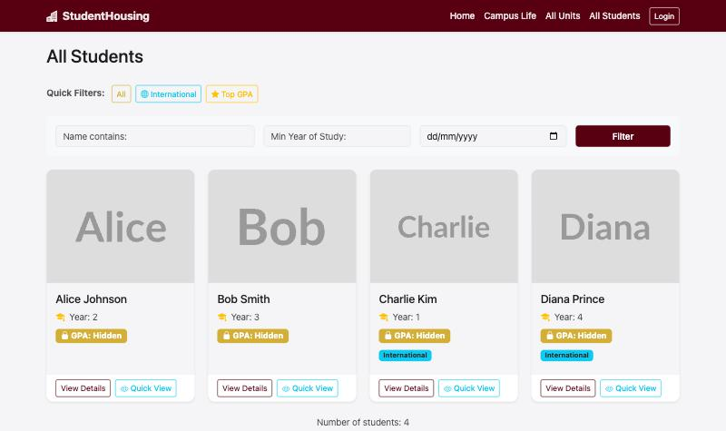

# Student Housing: Spring Boot web app and REST API

A Spring Boot application where student housing advisors manage students, housing units (apartments, studios, dorms) and leases. It has server-rendered Thymeleaf pages, a JSON REST API, role-based security with per-record ownership rules, and two JavaScript front-ends.



## Features

- **Students, housing units and leases:** search and filter students (name, year, birth date, "international", "top GPA"), view details, and rent a unit to a student. Capacity and active-lease rules are enforced in the service layer.
- **Security:** form login with BCrypt-hashed passwords and roles (admin, advisor). Record-level authorization with `@PreAuthorize`: only the owning advisor or an admin may edit or delete a student, and the GPA is only shown to them.
- **REST API** (`/api/students`, `/api/units`): proper HTTP verbs and status codes (`201` with `Location`, `204`, `400`, `403`, `404`, `409`), DTOs instead of entities, and errors as `application/problem+json`.
- **Performance-minded JPA:** open-session-in-view off, all associations lazy, and `JOIN FETCH` queries, so each page renders with a single SQL statement. All filtering happens in SQL, never in Java streams.
- **Front-ends:** an embedded npm/webpack bundle built automatically by Gradle, and a separate framework-less SPA client (`standalone-client/`) that talks to the REST API.
- **65 automated tests:** service unit tests with Mockito, web-layer tests with Spring Security test support, and integration tests against PostgreSQL.

## Tech stack

Java 21, Spring Boot 3.3 (Web, Data JPA, Security, Validation, Thymeleaf), MapStruct, PostgreSQL, JUnit 5, Mockito, Gradle (with the node-gradle plugin), JavaScript (ES modules), webpack, Sass, Bootstrap, ESLint, GitLab CI.

## Architecture

A strict three-layer design. Controllers only talk to services. Services own transactions, business rules and authorization, and they return DTOs. Repositories are plain Spring Data interfaces.

```mermaid
flowchart LR
    B[Browser<br/>Thymeleaf pages] --> MVC[MVC controllers]
    C[standalone-client<br/>fetch API] --> API[REST controllers]
    MVC --> S[Services<br/>@Transactional, @PreAuthorize]
    API --> S
    S --> M[MapStruct mappers<br/>entities to DTOs]
    S --> R[Spring Data repositories<br/>JOIN FETCH, SQL filtering]
    R --> DB[(PostgreSQL)]
```

Domain: `Student` and `HousingUnit` are linked through a `Lease` entity that carries dates, deposit and status. `Dorm` extends `HousingUnit` with single-table inheritance. `AppUser` advisors own the students they create.

More detail on every design decision is in [docs/course-notes.md](docs/course-notes.md).

## Getting started

Prerequisites: JDK 21 and Docker. Gradle downloads Node for the embedded front-end automatically.

```bash
git clone https://github.com/miqqayell/student-housing-spring.git
cd student-housing-spring
docker compose up -d      # dev database (port 6432) and test database (port 5433)
./gradlew bootRun         # http://localhost:8080
./gradlew test            # 65 tests, against the test database
```

Demo accounts (local seed data only): `admin` / `admin123`, `advisor1` / `advisor123`, `advisor2` / `advisor123`.

Standalone client (needs the backend running):

```bash
cd standalone-client
npm install
npm start                 # http://localhost:9000
```

## What I learned

- **Spring Boot and JPA in depth:** lazy loading, `JOIN FETCH`, cascading and transaction boundaries, and how to avoid N+1 queries and `LazyInitializationException`.
- **SQL:** moving filtering and counting into parameterized queries instead of loading whole tables.
- **Security:** Spring Security with roles, method-level authorization and CSRF-safe state changes.
- **REST design:** resource URLs, status codes, content negotiation and problem-detail errors.
- **Refactoring from feedback:** reworking controllers, layering and tests after exam feedback, and documenting what changed and why.

## Context

University project, KdG Applied Computer Science, Programming 5, 2025-2026. Solo project.

## Possible improvements

- Use Testcontainers so the tests start their own database.
- Add pagination to the student and unit lists.
- Replace the demo seed accounts with a proper first-run admin setup.
